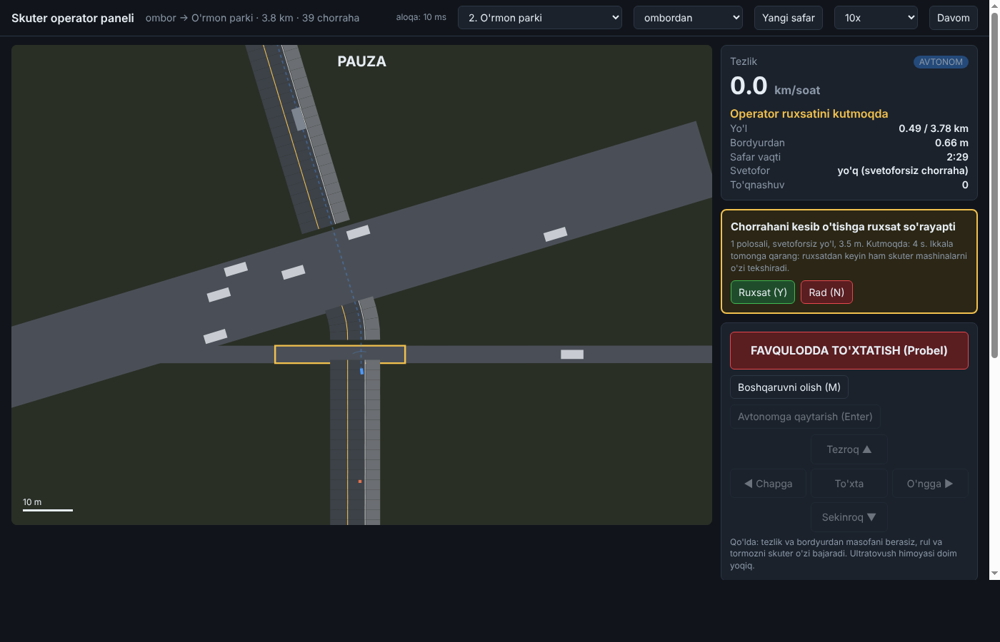

# Virtual shahar simulyatsiyasi (2D, 2-versiya)

Skuterning o'z dasturini (`autopilot/`) virtual shaharda sinaydi: piyodalar, ustunlar, daraxtlar,
to'satdan chiqqan odam, kamera nosozligi, burilishlar, mashinalar yuradigan yo'lni kesib o'tish, svetoforlar.

    python3 -m pip install matplotlib   # faqat grafik uchun
    cd sim/world
    python3 sinovlar.py 200             # 16 ta aniq ssenariy + 200 ta tasodifiy trotuar + 100 ta shahar marshruti

## Nima sinaladi

| Fayl | Nima |
|---|---|
| `autopilot/haydash.py` | **Skuter dasturi** (keyin skuterga o'rnatiladi): obyektlarni kuzatish, yo'l tanlash, tezlik, xavfsizlik qatlami, operatorni chaqirish |
| `autopilot/marshrut.py` | Marshrut xaritasi: trotuar, burilish, yo'l o'tish joyi; burilishdan oldin sekinlashish |
| `autopilot/otish.py` | Yo'lni kesib o'tish: to'xtash chizig'i, svetofor, mashinalar oralig'i, operator tasdig'i |
| `autopilot/avtopilot.py` | Hammasini birlashtiruvchi `Avtopilot` klassi (yarim va to'liq avtonom rejim) |
| `sim/world/dunyo.py` | **Simulyator**: marshrut, piyodalar, mashinalar, svetofor, operator, kamera va ultratovush modeli, skuter harakati |
| `sim/world/sinovlar.py` | Ssenariylar va o'tish shartlari |

Dastur qismlari:
1. **Kuzatuvchi**: kameraning shovqinli aniqlashlarini silliqlaydi, tezlikni baholaydi, odam va ustunni alohida kuzatadi.
2. **Rejalovchi**: 17 ta yon yo'lakni (va kerak bo'lsa ilon izi yo'lni) sinab, odamlardan 40 sm, ustunlardan 15 sm
   uzoqlikda o'tadigan eng qulay yo'lni tanlaydi. Oldidagi odamga 1,5 m masofada ergashadi.
   Yonidan odam o'tayotganda joyida kutadi.
3. **Xavfsizlik qatlami** (mikrokontrollerda): ultratovush yo'lda yaqin narsani ko'rsa favqulodda tormoz;
   kameradan 0,3 s ma'lumot kelmasa to'xtaydi.
4. **Yordam nazoratchisi**: 30 s ichida 1 m ham siljimasa, operatorni chaqiradi (yo'l o'tish joyida 120 s).
5. **O'ng tomon qoidasi**: yo'l bo'sh bo'lsa trotuar markazidan 40 sm o'ngroqda yuradi.
6. **Burilish**: yon tezlanish 0,8 m/s² dan oshmasligi uchun burilishdan oldin sekinlashadi (r = 3 m da ~5,6 km/soat).
7. **Yo'lni kesib o'tish**:
   - o'tish joyidan oldin chiziqda to'xtaydi;
   - svetofor bo'lsa, piyodaga yashil va o'tib ulgurishga yetarli vaqt (+3 s) qolgan bo'lsa o'tadi;
   - svetofor bo'lsa ham mashinalarni tekshiradi (qizilda o'tib ketadigan haydovchilar);
   - svetofor bo'lmasa, har bir polosada mashina yetib kelguncha chiqib ulgurish + 2,5 s zaxira bo'lishi kerak;
   - yarim avtonom rejimda svetoforsiz joyda operator tasdiqlaydi; to'liq avtonom rejimda o'zi qaror qiladi;
   - oldida sekin odam bo'lsa, shu tezlikda o'tishini hisobga oladi; yo'lga chiqqach to'xtamaydi, 8 km/soat bilan o'tadi.

## Natijalar

Oxirgi natija: `natijalar.txt` va `natijalar.png`.

## Simulyatsiya topgan xatolar (tuzatildi)

1. Ultratovush yon tomondagi narsani ham "oldinda" deb hisoblab, skuterni ustun yonida abadiy to'xtatib qo'yardi.
2. Rejalovchi faqat 3 s oldinga qarardi va ustunni juda kech ko'rardi; endi turg'un narsalarga 10 m oldindan qaraydi.
3. Kamera shovqini tufayli skuter ustunni goh chapdan, goh o'ngdan aylanmoqchi bo'lib tebranardi;
   endi kuzatuvchi ustun joyini o'rtachalaydi va rejalovchi tanlagan tomonida qoladi.
4. Kuzatuvchi ustunni yonidan o'tgan odam bilan "adashtirib", ustunni odam deb hisoblardi.
5. Sekin yuruvchi odamning orqasidan to'liq tezlikda yaqinlashib, favqulodda tormoz berardi; endi 1,5 m masofada ergashadi.
6. Yonidan odam o'tib turganda burilib ketsa, skuterning orqasi odamga tegib ketardi; endi odam o'tguncha kutadi.

7. (2-versiya) Svetofor yashil yonganda skuter "otish" holatiga o'tsa ham, qizilda kutgan vaqti "qotib qoldi" deb
   hisoblanib operator chaqirilardi; endi yo'lga chiqish boshlanganda kutish hisobi qaytadan boshlanadi.
8. (2-versiya) To'liq avtonom rejimda skuter yo'lga sekin yuruvchi odam orqasidan chiqib, mashinalar oralig'ini 8 km/soat
   uchun hisoblagan, aslida 2-3 km/soatda o'tgan: mashina bilan to'qnashuv. Endi oldidagi odam tezligini hisobga oladi.
9. (2-versiya) To'xtash chizig'ida turgan mashinani kamera shovqini tufayli "o'tish joyiga kiryapti" deb ko'rib,
   skuter svetofor yashil bo'lsa ham o'tmasdi.
10. (2-versiya) Ikki to'siq ketma-ket turganda (biri chapda, biri o'ngda, 4-7 m oraliqda) ilon izi yo'lni topa olmay,
    to'g'ri borib to'siq oldida qotib qolardi. Endi uzoqroq ilon izi variantlari bor va yo'l topilmasa ham
    eng bo'sh tomonga oldindan buriladi.

## Cheklovlar (keyingi versiyalarda)

- Xarita oldindan ma'lum (marshrut bo'laklari) deb olingan; haqiqiy xarita va joylashuv keyingi bosqichda.
- Mashina va svetofor holati kameradan "shovqinli aniqlash" sifatida keladi; haqiqiy aniqlash 3D/video sinovida.
- Skuter orqaga yura olmaydi: to'siqqa juda yaqin kelib qolsa, operatorni chaqiradi.
- Kamera haqiqiy tasvir emas, "shovqinli aniqlash" modeli. Haqiqiy kamera Gazebo/Isaac Sim va Chirchiq videolarida sinaladi.
- Piyodalar modeli sodda: ba'zan turgan skuterga o'zlari kelib tegadi (natijada alohida sanaladi, skuter xatosi emas).
- Skuter burilganda orqa qismining yon tomonga surilishi rejalovchida hisobga olinmagan; buning o'rniga
  odam yonida bo'lsa skuter kutadi.
- Juda tor ilon izi joylarda (ikki to'siq orasi 1,5 m dan kam) skuter operatorni chaqiradi.

# 3-bosqich: yo'lda yurish (`yol_sinovlar.py`)

Trotuarlar skuter uchun moslanmagani sababli skuter **yo'lning o'ng chetida** yuradi (trotuar dasturi faqat
eshik oldidagi oxirgi 20-50 m uchun qoladi).

    cd sim/world
    python3 yol_sinovlar.py 200   # 14 ta aniq ssenariy + 200 ta tasodifiy ko'cha

| Fayl | Nima |
|---|---|
| `autopilot/yol.py` | **Skuter dasturi (yo'l)**: kuzatuvchi, rejalovchi, chorraha, xavfsizlik qatlami |
| `sim/world/yol_dunyo.py` | **Ko'cha simulyatori**: polosalar, parkovka, velosiped yo'lagi, mashinalar (IDM), avtobus, velosipedchi, odamlar, svetofor, ko'ndalang oqim |
| `sim/world/yol_sinovlar.py` | Ssenariylar va o'tish shartlari |

Yo'lda `d` = o'ng bordyurdan chapga masofa (m). Ko'cha o'ngdan chapga: `[parkovka][velosiped yo'lagi][polosalar]`.

## Skuter qoidalari

1. **Joyi**: velosiped yo'lagi bo'lsa uning o'rtasida; bo'lmasa bordyurdan 0,8 m; parkovka bo'lsa ochilgan eshikdan
   (1 m) tashqarida.
2. **Tezlik**: eng ko'pi 20 km/soat; to'xtagan mashinalar qatori yonida 12 km/soat (orasidan odam chiqishi mumkin).
3. **Aylanib o'tish** (chetda to'xtagan mashina, avtobus, to'siq, sekin velosipedchi): faqat orqadan kelayotgan
   mashina bemalol sekinlasha olsa (oraliq ≥ v·1,5 s + farq²/(2·2 m/s²) + 8 m). Yonimizda yoki orqamizda
   mashina o'tayotgan bo'lsa, chapga surilmay joyida kutadi. Chorrahaga 5-15 m qolganda aylanishni boshlamaydi.
4. **Ergashish**: oldingi transportdan 1,5 s + 3 m.
5. **Odamlar**: yo'li bizning yo'lakni kesadigan odam oldida to'xtaydi.
6. **O'ngga buriluvchi mashina** (chorraha oldida, signal bergan): unga yo'l beradi.
7. **Chorraha**: yashilda va mashina bo'lmasa to'xtamasdan o'tadi; chap burilish ikki bosqichda (chorrahani ikki marta
   kesib o'tish). Chorrahadan keyin joy bo'lmasa (to'xtagan avtobus, tirbandlik), chorrahaga kirmaydi.
   Chiroq o'zgarganda qulay to'xtay olmasa o'tib ketadi ("sariq dilemma"), lekin mashina xavfi bo'lsa doim to'xtaydi.
   Kamera bir-ikki kadrda mashinani ko'rmay qolsa ham uni 0,6 s eslab qoladi.
8. **Burilishning ichki tomoni**: s bo'yicha tezlik haqiqiy tezlikdan katta bo'lgani uchun tormoz masofasi to'g'rilanadi.

## Simulyator

- Mashinalar IDM modeli bilan yuradi, skuterni polosa ichida yoki qo'shni polosaga o'tib quvib o'tadi
  (bir polosali yo'lda qarama-qarshi polosaga chiqib). 2% haydovchi e'tiborsiz (skuterni juda kech ko'radi),
  25% o'ngga buriladi, ko'ndalang oqimda 3% qizilda o'tib ketadi.
- To'xtagan mashinalar orasidan chiqadigan odamlar (25% e'tiborsiz), avtobus bekatlari, to'siqlar, velosipedchilar.
- Kamera: oldinga 50 m, orqaga 60 m, shovqin, 3% ko'rmay qolish; har 5-marshrutda kamera 0,5-3 s o'chadi.

## Natija (200 ta tasodifiy ko'cha)

| Ko'rsatkich | Natija |
|---|---|
| Manzilga o'zi yetdi | 176/200 |
| Qotib qolib operator chaqirdi | 24/200 (12%) |
| Mashina / velosipedchi / to'siq / ko'ndalang mashina bilan to'qnashuv | 0 / 0 / 0 / 0 |
| Odam bilan to'qnashuv | 1 (kocha-192, pastda) |
| Bordyurga tegish, eshik zonasidan o'tish | 0, 0 |
| O'rtacha tezlik | 12,3 km/soat |

CI 150 ta marshrut bilan ishlaydi (kocha-192 kirmaydi), aniq ssenariylarning hammasi o'tadi.

## Ochiq qolgan xavflar

- **kocha-192**: e'tiborsiz odam to'xtagan mashinalar orasidan skuterning naq yonidan (0,7 m oldida) chiqib, skuterga
  kirib ketadi. Bunda hech qanday tezlikda to'xtab bo'lmaydi; yagona yechim parkovka yonida sekinroq yurish yoki
  ulardan uzoqroq yurish. Haqiqiy sinovda bu holat kuzatiladi.
- Simulyatordagi ba'zi mashinalar skuterni 0,3 m yaqindan quvib o'tadi. Haqiqiy yo'lda orqa kamera va
  ko'rinadigan chiroqlar/bayroqcha kerak.
- Qotib qolishlarning ko'pi: bekatda turgan avtobus orqasida, tirband polosa yonida yoki chorrahadan keyin joy
  bo'lmaganda. Skuter orqaga yura olmaydi; bu holatda operator boshqaradi.
- Xarita (Yandex) va joylashuv hali ulanmagan: marshrut bo'laklari oldindan ma'lum deb olingan.

# 4-bosqich: xaritadan marshrut (`xarita_sinovlar.py`)

`autopilot/xarita.py` ikki nuqta (kenglik, uzunlik) orasida skuter yo'lini topadi va uni dastur tushunadigan
bo'laklarga (yo'l, burilish, chorraha) aylantiradi.

**Nega hozir OpenStreetMap:** Yandex xaritalarining bepul API shartlari pullik loyihada ishlatishni, ma'lumotni
saqlashni (oflayn nusxa) va transportni kuzatish tizimini taqiqlaydi, marshrut esa faqat Yandex MapKit ilovasida
beriladi ([shartlar](https://yandex.ru/legal/maps_api/), 4.1.1, 5.1.3, 5.1.5, 6.2.1). OSM bepul, tijoratda
ishlatish va oflayn saqlash mumkin (ODbL, mualliflik ko'rsatiladi). Modul manbaga bog'lanmagan: Yandex tijorat
litsenziyasi olinsa, faqat o'quvchi funksiya qo'shiladi.

Qoidalar:
- motorway/trunk ishlatilmaydi, primary qimmatroq (kichik ko'chalar afzal), bir tomonlama ko'chaga teskari kirilmaydi;
- 3 va undan ko'p tarmoqli tugun chorraha: to'g'ri kesib o'tish (`otish`), o'ngga r = 6 m burilish,
  chapga ikki bosqich (ko'ndalang ko'cha, burchakda burilish, o'z ko'chamiz);
- svetofor (tugunda yoki 25 m ichida), polosalar soni, velosiped yo'lagi va parkovka OSM teglaridan olinadi.

Sinov (`python3 xarita_sinovlar.py`): sun'iy shaharda (Chirchiq emas) 10 ta tasodifiy manzil: yo'l qoidalari va
marshrut uzunligi tekshiriladi, keyin har marshrut tasodifiy transport bilan simulyatorda bosib o'tiladi.
Natija: 10 tadan 10 tasi xavfsiz, 8 tasi o'zi yetdi, 2 tasida operator.

## Chirchiq xaritasida sinov

    python3 xarita_sinovlar.py --chirchiq 10   # ombordan 10 manzilga, har biri 10 marta (100 ta yetkazish)

Xarita: `xaritalar/chirchiq.osm.gz` (OpenStreetMap, 2026-10-12 da overpass-api.de dan yuklangan,
41.43-41.53 sh.k., 69.52-69.64 sh.u.; (c) OpenStreetMap hissadorlari, ODbL). Unda 2627 ta yo'l, lekin atigi
18 ta svetofor belgilangan: haqiqatda ko'proq bo'lishi mumkin, joyida tekshirish kerak.

Ombor va 1-5 manzilni Isroil bergan: ombor Navoiy (Markaziy) bozoriga yetmasdan; manzillar Jismoniy tarbiya
instituti (Troitsk), O'rmon parki, Chirchiq bozori, 8-kichik nohiya, Oktyabr. 6-10 manzilni Claude tanlagan
(pedagogika universiteti, shoshilinch yordam markazi, 4-kichik nohiya, Do'stlik mahallasi, Kimyogar sport majmuasi).
Koordinatalar OSM dagi shu nomli joylardan olingan.

Natija (100 ta yetkazish, 1,3-7,9 km): **to'qnashuv 0**, 58 tasida skuter manzilga o'zi yetdi, 42 tasida
operator chaqirildi (2026-10-13; avval 45 va 55). Operator chaqiruvining 41 tasi chorrahada: ombordan g'arbga
boradigan har marshrut svetoforsiz Alisher Navoiy shoh ko'chasini (ajratilgan, 2+2 polosa) kesadi. Svetoforsiz
katta ko'chalarda 112 marta kutildi: o'rtacha 73 s, mediana 43 s, eng uzoq 425 s. Eng yomon manzil - Shoshilinch
tibbiy yordam markazi (1/10): u yerga Navoiy ko'chasiga chapga burilib (ikki marta kesib) boriladi. To'liq jadval
`natijalar_chirchiq.txt`, xarita `natijalar_chirchiq.svg`.

### Katta ko'chada kutish (2026-10-13)

Kutish chegarasi olib tashlansa, Navoiy ko'chasida kutish 2 s dan 27 daqiqagacha bo'ldi (mashinalar oqimi
bir polosada 0,07-0,17 mashina/s, ya'ni 240-600 mashina/soat; haqiqiy oqim o'lchanmagan). Shuning uchun:

- `otish.kutish_bahosi(b)`: o'tish joyida kutishning taxminiy o'rtacha vaqti xaritadagi oqim, polosalar soni va
  kenglikdan (Puasson oqimi, Adams formulasi). Simulyatorda o'lchangan o'rtacha bilan mos keladi.
- Marshrut 6 tagacha variantni solishtiradi: har safar eng uzoq kutiladigan chorrahaga jarima qo'yib qayta
  qidiradi va "yo'l narxi + 4,5 m x kutish soniyasi" eng kichigini oladi. Masalan, Oktyabrga yo'l endi Navoiy
  ko'chasini ikki marta (chapga burilib) emas, bir marta to'g'ri kesadi.
- Xaritaga ko'ra uzoq kutiladigan o'tishda operator 120 s da emas, kutilgan vaqtning 3 baravarida (eng ko'pi
  10 daqiqa) chaqiriladi: bu kutish oldindan ma'lum, operator uni xaritada ko'rib turadi.
- Simulyator: mashina va avtobus chorraha / o'tish joyiga 5 m dan yaqin to'xtamaydi (qoida). Avval avtobus
  chorrahadan 1 m keyin abadiy turib, skuterni chorrahaga kiritmay qo'yardi.
- O'ngga burilishdan keyin 1-2 m da turgan to'siqni skuter aylanib o'tmay, abadiy kutardi (burilishning oxirgi
  2 m i endi hisobga olinmaydi).

### 1000 km sinovi (2026-10-14)

    python3 xarita_sinovlar.py --km 1000

"Skuterga tayyor" 1-mezoni: Chirchiqda ombordan 10 manzilga borib-qaytib, jami 1000 km. Natija
(`natijalar_1000km.txt`): **1001 km, 376 safar, to'qnashuv 0**. 200 safarda skuter o'zi yetdi, 176 tasida operator
chaqirildi (asosan Navoiy ko'chasida, operator yordami bilan safar shu yerda tugaydi deb hisoblanadi).

Birinchi uchta 1000 km yugurishida 1-3 tadan to'qnashuv chiqdi. Tuzatilganlari:
- E'tiborsiz haydovchi chorraha oldida keskin tormoz bergan skuterga orqadan urildi: endi chiziqqa yumshoq
  tormoz (1,2 m/s²) bilan oldinroq sekinlashadi va chiziqda bordyurga yaqinroq (0,55 m) turadi.
- Chapga ikki bosqichli burilishda ikkinchi o'tish chizig'ida skuter qotib qolardi.
- To'xtab turgan joyidan qo'zg'alganda yonga keskin burilib, orqa qismi yonidan o'tayotgan velosipedchiga tegdi:
  endi qo'zg'alishdan oldin orqa va yonini tekshiradi, past tezlikda yonga asta suriladi, chorrahani kesayotganda
  yonga surilmaydi.
- Chapga keskin burilishga ichki tomondan (to'siqni aylanib o'tgandan keyin) kirganda skuter bunday radiusda
  burila olmay bordyurga surildi: endi burilish oldidan ichki tomon cheklanadi (eng kichik radius 2,9 m).

### Haqiqiy xaritada topilgan xatolar (tuzatildi)

Sun'iy shaharda ko'rinmagan, birinchi Chirchiq yugurishida 50 ta yetkazishdan 11 tasida to'qnashuv bo'lgan
(1-6), haqiqiy ombor bilan yana 100 tadan 1 tasida (7-8):

1. **Ikki tugunli chorraha.** OSM'da ajratilgan yo'l (o'rtasida ajratuvchi bor) ikki yaqin chorraha bo'lib chizilgan
   (orasi 1-2 m). Skuter birinchisini o'tib, ikkinchisi oldida to'xtay olmay, uning **o'rtasida** to'xtab qolardi.
   Endi orasi 10 m dan kam o'tishlar bitta keng o'tish deb kesib o'tiladi.
2. **To'siq chorrahadan keyin.** Chorrahadan 5-10 m keyin mashina yoki avtobus turgan bo'lsa, skuter chorraha
   ichida to'xtab qolardi (to'xtash masofasi xato hisoblangan). Endi to'siqni aylanishni chorrahadan oldin boshlaydi
   (velosipedchilar kabi chaproqda kesib o'tadi), yoki orqa bo'sh bo'lmasa chorrahaga kirmay kutadi.
3. **Yondagi piyoda.** Skuter to'siq orqasida turganda, uning yonidan yo'lga tushgan odamni "orqada" deb hisoblab,
   joyidan qo'zg'alardi. Endi yonidagi odam ham hisobga olinadi.
4. **Ko'cha tartibi o'zgarganda** (masalan chorrahadan keyin parkovka boshlansa) skuter orqaga qaramay chapga
   surilardi. Endi orqadan mashina kelayotgan bo'lsa, u o'tib ketguncha joyida qoladi.
5. **Marshrut katta ko'chalarni svetoforsiz kesishdan qochadi**: chorrahada kesib o'tiladigan yo'l turiga qarab
   qo'shimcha narx (primary 200 m, secondary 120 m, svetofor bo'lsa 4 marta kam).
6. Faqat skuter yura oladigan asosiy tarmoqqa (tranzit yo'llar ajratib qo'ygan kichik bo'laklarga emas) manzil
   bog'lanadi; aks holda ba'zi manzillarga yo'l topilmasdi.
7. **Sekin velosipedchini cheksiz quvish.** Skuter oldidagi sekin velosipedchini aylanib o'tishni har safar
   cho'zib, 100 m dan ko'p polosada yurdi va chapga burilish chorrahasiga yon tomonda kirib, ikkinchi o'tish
   ichida to'xtab qoldi. Endi aylanish faqat turgan (yoki allaqachon yonidagi) narsa uchun cho'ziladi; chapga
   ikki bosqichli burilishdan oldin yon tomonda turib chorrahaga kirilmaydi; keyingi o'tish yaqin bo'lsa
   hozirgisini uning chizig'ida to'xtay oladigan tezlikda o'tadi.
8. Aylanishdan **o'ngga qaytishda** ham orqaga qaraydi (o'ng tomondan kelayotgan velosipedchi).

Simulyatorning o'zida ham tuzatildi: chorrahadagi ko'ndalang oqim ko'cha turiga qarab (hovli ko'chasida kam, katta
ko'chada ko'p), 900 s dan uzun marshrutlarda ham mashinalar bor; velosipedchi va mashinalar avtobus orqasida
abadiy tiqilib qolmaydi (chapdan aylanib o'tadi). 3-bosqich sinovi shu o'zgarishlardan keyin ham o'tadi
(150 ko'cha: to'qnashuv 0, operator 12/150; avval 17/150).

### Keyingi qadamlar

- Alisher Navoiy ko'chasi: ombor yonida mashinalar oqimini joyida sanash (yetkazish soatlarida 5 daqiqa, har
  polosada) va eng yaqin svetoforni aniqlash. Oqim bir polosada 0,05 mashina/s (180/soat) dan kam bo'lsa skuter
  o'zi o'tadi; ko'p bo'lsa svetoforli joydan o'tish, operator tasdig'i yoki omborni g'arbiy tomonga ko'chirish.
- Chirchiqdagi svetoforlarni joyida (yoki videodan) xaritaga qo'shish.

# B bosqich: operator paneli (`operator_panel.py`, 2026-10-15)

Operator virtual skuterni brauzerdan kuzatadi va masofadan boshqaradi. Simulyator Chirchiq xaritasida
ombordan tanlangan manzilga real vaqtda (yoki 2x-10x tez) yuradi.

    python3 operator_panel.py              # brauzerda http://localhost:8765
    python3 operator_panel.py --manzil 3 --tezlik 2

Panelda:
- yuqoridan ko'rinish (skuter yo'nalishi doim tepaga): yo'l, polosalar, velosiped yo'lagi, mashinalar,
  chorrahadagi ko'ndalang mashinalar, odamlar, so'ralayotgan chorraha sariq ramkada;
- tezlik, holat (masalan "Operator ruxsatini kutmoqda"), bordyurdan masofa, svetofor, to'qnashuvlar soni;
- kichik xarita: marshrut va skuter qayerda; hodisalar jurnali; yangi so'rov kelganda ovozli signal.

Operator nima qila oladi (tugma yoki klaviatura):
| Amal | Tugma |
|---|---|
| Chorrahadan o'tishga ruxsat / rad | Y / N |
| Boshqaruvni olish (qo'lda) / avtonomga qaytarish | M / Enter |
| Qo'lda: tezroq / sekinroq / to'xta | W yoki ↑ / S yoki ↓ / X |
| Qo'lda: bordyurdan uzoqroq / yaqinroq | A yoki ← / D yoki → |
| Favqulodda to'xtatish / davom | Probel |
| Simulyator: pauza, tezligi, yangi safar | P, yuqoridagi menyular |

Xavfsizlik qoidalari (skuter dasturida, operator ularni o'chira olmaydi):
- Chorrahaga ruxsat berilsa ham skuter mashinalarni o'zi yana tekshiradi; mashina ko'rsa o'tmaydi va
  jurnalga "Skuter o'tmadi" yoziladi.
- Skuter ruxsatni faqat operator javob bergunicha (2 s) ham bo'sh joy qoladigan paytda so'raydi. Avval
  zich oqimda so'rov ketidan so'rov kelardi (sinovda 59 ta, 53 tasi foydasiz); endi 9 ta.
- Qo'lda boshqarishda operator faqat tezlik va bordyurdan masofani beradi, rulni skuter o'zi buradi.
  Burilishdagi tezlik cheklovi, ultratovush va kamera himoyasi ishlaydi: buyurilgan yo'lakda oldinda
  to'siq bo'lsa, 1,5 m oldin to'xtaydi (faqat ultratovush 4 m ko'radi, 20 km/soatda bu yetmaydi).
- Yordam so'rovi endi safarni tugatmaydi: skuter joyida kutadi, operator boshqaruvni oladi yoki avtonom
  davom ettiradi. Qo'lda chorrahaga kirib avtonomga qaytarilsa, skuter yo'l o'rtasida qayta ruxsat
  so'ramaydi, o'tib ketadi.

Sinovlar (`python3 operator_sinovlar.py`, CI da ham): dastur operator rolini o'ynaydi.
1. ruxsat beradi, 1b. ko'ndalang oqimda doim ruxsat beradi (skuter o'zi tekshiradi, to'qnashuv yo'q),
2. ikki marta rad etadi, 3. qo'lda boshqarib qaytaradi, 4. favqulodda to'xtatadi, 5. so'rovga javob
bermaydi, yordam so'rovida boshqaruvni olib chorrahadan o'tkazadi, 6. to'xtagan mashinaga qarab
20 km/soatda boshqaradi (skuter to'xtaydi), 7. HTTP server, 8. parol, 9. Telegram bot, 10. sinov kamerasi.

Cheklovlar: parol HTTP Basic bilan; simulyator skuteri uchun video yo'q (sxema ko'rsatiladi, sinov kamerasi
alohida, quyida); aloqa kechikishi va uzilishi simulyatorda hali modellashtirilmagan.
Haqiqiy skuterda shu interfeys (so'rov, ruxsat, qo'lda buyruq, to'xtatish) mobil aloqa orqali ishlaydi.

## Serverga joylash va Telegram bot (2026-10-15)

Serverda (Ubuntu/Debian, root) bitta buyruq: kodni `/opt/autopilot` ga oladi, `skuter-operator` systemd
xizmatini yoqadi (`--davomli`: safarlar ketma-ket, to'xtovsiz), tasodifiy parol yaratadi va manzilni chiqaradi.

    curl -fsSL https://raw.githubusercontent.com/Arab04/autopilot/claude/project-thread-gxkale/deploy/ornat.sh | bash
    # Telegram bot bilan:
    curl -fsSL .../deploy/ornat.sh | TELEGRAM_TOKEN=123:ABC OPERATOR_CHATLAR=111,222 bash

Panelga kirish: login `operator`, parol `/etc/skuter-operator.env` da. Tarmoqqa ochilganda parolsiz ishlamaydi.

Telegram bot (`operator_bot.py`): skuter chorrahada ruxsat so'rasa yoki qolib ketsa, ro'yxatdagi
operatorlarga xabar yuboradi ([Ruxsat] [Rad] yoki [Avtonom davom] [To'xtatish] tugmalari, "Panelni ochish").
Birinchi javob ishlaydi, qolganlarda tugmalar olib tashlanadi; eskirgan so'rovga bosilgan tugma hech narsa
qilmaydi; ro'yxatda yo'q odam boshqara olmaydi. Buyruqlar: `/start` (chat raqamini aytadi), `/holat`,
`/toxtat`, `/davom`.

## Sinov kamerasi: telefon skuter kamerasi o'rnida (2026-10-15)

Skuter yig'ilguncha telefon kamerasi operator paneliga ulanadi: Chirchiqda 4G orqali video qancha
kechikishini skutersiz o'lchash uchun.

1. Telefonda `https://<server>/kamera` ni ochib, panel login/paroli bilan kiring, "Uzatishni boshlash".
2. Operator panelida (o'ng ustun tepasida) video, kadr/s, trafik va taxminiy kechikish ko'rinadi.
   Video bosilsa katta ochiladi.

Qanday ishlaydi (`kamera.py`, `kamera.html`): telefon har kadrni JPEG qilib `POST /kamera/kadr` ga yuboradi
va javobni kutadi (aloqa sekinlashsa kadrlar navbatga yig'ilmaydi, kamroq yuboriladi). Panel
`GET /kamera/oqim` dan MJPEG oqimini oladi. Kechikish = telefon o'lchagan yuborish vaqtining yarmi + kadrning
serverdagi yoshi. Har kadrga telefon soati yoziladi: operator ekrani va telefonni birga suratga olib, to'liq
kechikishni ham tekshirsa bo'ladi.

Brauzer kamerani faqat HTTPS sahifada beradi, shuning uchun `ornat.sh` Caddy o'rnatadi va
`<ip>.sslip.io` domeniga Let's Encrypt sertifikati oladi (`DOMEN=...` bilan o'z domeningiz, `HTTPS=0` bilan
o'chiriladi). Serverda 80 va 443 portlar ochiq bo'lishi kerak.

Bu faqat sinov uchun: haqiqiy skuterda video Jetson'dan WebRTC (H.264) bilan uzatiladi, MJPEG trafigi ancha
katta (640x480, 10 kadr/s taxminan 0,7 Mbit/s).
